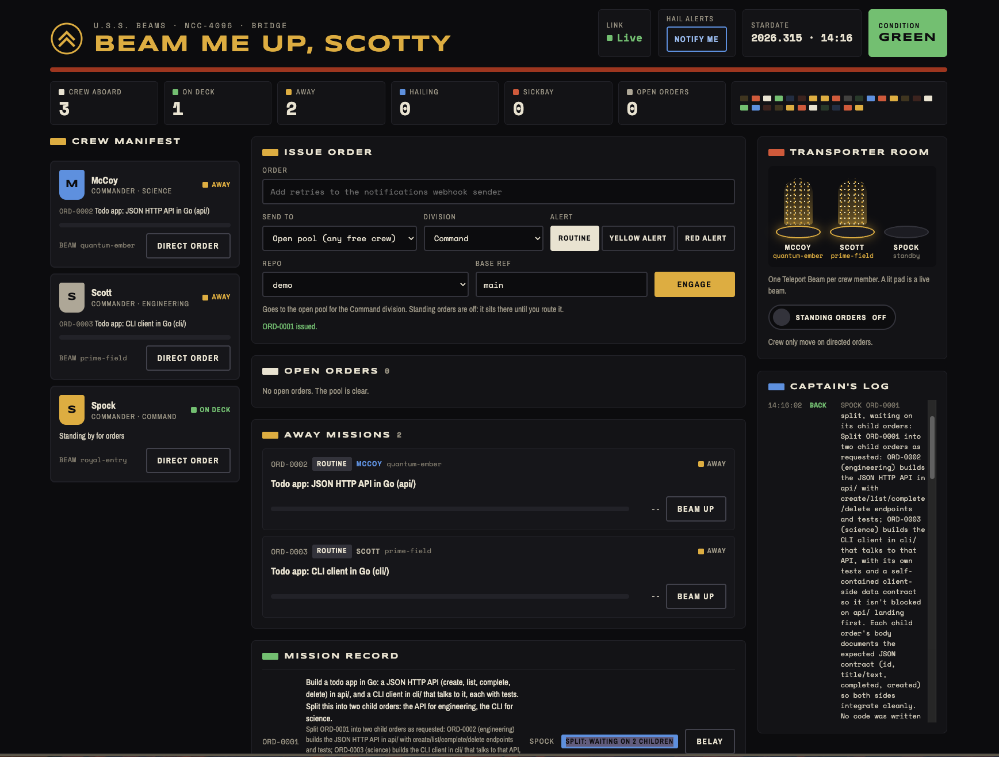

# BEAM ME UP, SCOTTY

A bridge that runs a crew of coding agents on Teleport Beams. Design and decisions live in [`spec/`](spec/).



## Quick start

You need Go 1.26, Node 22 or later, `tsh` 18.8 or later, and a Teleport cluster with Beams. Crew members run Claude Code on their beams, which reaches the model through the cluster, so there is no API key to set.

```sh
make                                              # builds combadge and ./bmus
tsh login --proxy=example.teleport.sh             # your cluster
./bmus bridge run --repo app=git@github.com:you/app.git &   # from the repo root, where it finds combadge
./bmus crew add sorell --name Sorell --division science
./bmus console                                    # opens the console in your browser
```

The bridge keeps its state in `~/.bmus` (`BMUS_HOME` to change it; keep the path short). The crew member shows as beaming in until its beam is up and its combadge says hello, then on deck. Give it an order from the console's Issue Order panel, or from the CLI:

```sh
cat > order.yaml <<'EOF'
title: README greeting
assignee: sorell
repos:
  - name: app
    base_ref: main
body: Add a one-line greeting at the end of README.md and commit it.
EOF
./bmus order create order.yaml
```

Answer its hails in the console, or with `./bmus hails list` and `./bmus hails answer`. Once it's done, read its mission report in the console and push its branch with Push, or `./bmus order push ORD-0001`. To try bmus without a cluster, see [Running the bridge locally with holodeck](#running-the-bridge-locally-with-holodeck).

## Roadmap

A ticked item works on `main`. The plan behind it is in [`spec/initial-plan-2026-10-16.md`](spec/initial-plan-2026-10-16.md#9-delivery-plan) and [`spec/campaigns-plan-2026-11-03.md`](spec/campaigns-plan-2026-11-03.md#6-stages).

### Phase 1: one crew member, end to end

- [x] Run a crew member on a real beam over `tsh`
- [x] Give an order to a named crew member
- [x] Ship the order's repo into the beam and get the finished work back as a local branch
- [x] Answer the crew's hails from the CLI
- [x] Follow everything in the captain's log
- [x] Check the ship's condition with `bmus status`
- [x] Pick the harness and model per crew member
- [x] Restart the bridge mid-mission and the mission completes
- [x] Lose a beam and the crew member lands in sickbay with a checkpoint
- [x] Run the whole ship locally on holodeck beams

### Phase 2: fleet and console ([#2](https://github.com/tscolari/bmus/issues/2))

- [x] Define divisions and their default harness and model in a roster
- [x] Pool orders by division, with priorities, claimed under standing orders
- [x] Cap beams, concurrent provisioning and the provisioning rate
- [x] Swap a crew member's beam before its TTL and resume from a checkpoint
- [x] Recall, belay, withdraw and re-route orders
- [x] Push a done order's branch from the bridge
- [x] Read a done order's mission report, with its diff, in the console
- [x] Hold work through a `tsh` login expiry and resume after `tsh login`
- [x] Run the ship from a web console with live updates and hail notifications

### Phase 3: chain of command ([#3](https://github.com/tscolari/bmus/issues/3))

- [x] Set which hails are auto-allowed, go to Command or stay with the captain in `regs.yaml`
- [x] Command answers routed hails for you, steered by your guidance
- [x] Countermand a Command or timeout decision within its window
- [x] Command splits an order into child orders once you approve
- [x] Park a hail for long waits and resume the session on the answer
- [x] Measure the auto-resolved share, captain overrides and time-to-answer
- [x] Read orders from an issue tracker, GitHub Issues first ([#33](https://github.com/tscolari/bmus/issues/33))
- [x] Jettison the branches of orders that ended a while ago with `bmus jettison`

### Phase 4: hardening ([#109](https://github.com/tscolari/bmus/issues/109))

- [ ] Create beams through the Beams API, with restricted egress per division
- [ ] Grant a crew member's beam an extra domain through an egress hail
- [ ] Reap orphan beams and catch lost ones with a reconcile pass
- [x] Cap an order's tokens and turns, and extend or stop it when it runs over
- [x] Checkpoint at every park and on a cadence, with uncommitted work restored wherever an order starts
- [ ] Hardened console: CSRF on every request, one-time launch codes, session expiry, rate limits
- [ ] Nightly backups, and an offline restore
- [ ] Survive a chaos run of beam loss, sleep, login expiry and crashes with zero lost orders
- [ ] Scoped permissions per division, once Beams supports them

### Phase 5: drawing board ([#164](https://github.com/tscolari/bmus/issues/164))

- [ ] Redshirts: a beam for one order, destroyed on return
- [ ] Away teams: several crew on one parent order, led by Command
- [ ] Rank breaks ties when crew claim pool orders
- [ ] Shore leave: idle crew give up their beam and return on a fresh one
- [ ] An always-on bridge on another machine, with hails reaching you by push or Slack
- [ ] Run crew without a Teleport tenant: in containers, then in Firecracker microVMs ([#165](https://github.com/tscolari/bmus/issues/165), [#166](https://github.com/tscolari/bmus/issues/166))

### Campaigns

- [x] Stage 1: chain orders, so one waits for another and starts from its work ([#141](https://github.com/tscolari/bmus/issues/141))
  - [x] An order waits for the orders in its `after` ([#142](https://github.com/tscolari/bmus/issues/142))
  - [x] An order starts from another order's work ([#143](https://github.com/tscolari/bmus/issues/143))
  - [x] Rebase or reorder orders nobody has started, from the CLI or through Command ([#148](https://github.com/tscolari/bmus/issues/148))
- [ ] Stage 2: crew file findings as issues, and you discard the ones you don't want ([#150](https://github.com/tscolari/bmus/issues/150))
- [ ] Stage 3: `bmus campaign run --issue <ref>` implements, reviews, fixes and lands one task ([#179](https://github.com/tscolari/bmus/issues/179))
- [ ] Stage 4: run a campaign over a backlog query with an in-flight limit, respecting blockers
- [ ] Stage 5: land as a pull request or a merge on green CI, with stacked tasks

## Running the bridge locally with holodeck

Holodeck beams are local processes, so you need neither `tsh` nor a network. You do need Go and Node 22 or later.

```sh
(cd combadge && npm ci && npm run build)        # builds combadge/dist/combadge.mjs
go build -o bmus ./cmd/bmus

export BMUS_HOME=/tmp/bmus-dev                  # default ~/.bmus; keep it short (Unix socket paths)
./bmus bridge run --transporter holodeck \
  --holodeck-script combadge/test/fixtures/default.json \
  --repo bmus="$PWD" &                          # any URL git can fetch; cloned into $BMUS_HOME/repos/bmus

./bmus crew add sorell --name Sorell --rank Lieutenant --division science
cat > order.yaml <<'EOF'
title: holodeck run
assignee: sorell
repos:                                          # exactly one in Phase 1
  - name: bmus
    base_ref: main
body: Walk the script.                          # holodeck only; real beams need a real task (below)
EOF
./bmus order create order.yaml                  # prints ORD-0001
./bmus log tail --follow                        # Ctrl-C to stop
./bmus hails list                               # in another shell, once the crew hails
./bmus hails answer H-0001 --option 0
```

The bridge runs in the background of that shell. To stop it, run `kill %1`, or `fg` and then Ctrl-C. A graceful shutdown can take about a minute, and a second signal kills it at once.

Holodeck beams keep running after the bridge stops, as real beams would, and the next `bridge run` on the same home attaches to them again. To get rid of them, stop the bridge, then:

```sh
for f in "$BMUS_HOME"/holodeck/*/serve.pid; do kill -- "-$(cat "$f")"; done
rm -rf "$BMUS_HOME"
```

## Running on real beams

Build as above and run from the repo root (or pass `--combadge`). You need a `tsh` login to a cluster with Beams. The bridge runs `tsh` as you, and `--transporter tsh` is the default. Crew members run the sdk harness, which is Claude Code on the beam.

```sh
./bmus bridge run --repo bmus=git@github.com:you/bmus.git &
./bmus crew add sorell --name Sorell --rank Lieutenant --division science
cat > order.yaml <<'EOF'
title: README greeting
assignee: sorell
repos:
  - name: bmus
    base_ref: main
body: Add a one-line greeting at the end of README.md and commit it.
EOF
./bmus order create order.yaml
```

A new crew member is `beaming_in` while its tour provisions a beam and waits for its combadge to say hello, and claims no order until it is `on_deck`. `bmus crew list` shows its beam as `provisioning` until there is one. A watch change and a re-energize go through `beaming_in` too.

The body is the agent's task, so give it real work. The agent commits on `bmus/<order>` on the beam and never pushes. When the order is done, the bridge fetches that branch into `$BMUS_HOME/repos/<name>` (default `~/.bmus`), and pushing it is up to you. Follow it with `log tail` and `hails` as above.

The bridge needs your `tsh` login to stay valid. `bmus status` turns yellow 30 minutes before the login expires (`tsh login expires in <n>m`). From 2 minutes before the expiry (`tsh login expired`), the bridge runs no new `tsh` command until you run `tsh login`. Crew members stay on deck and claim no new orders. Provisioning and an order's transfers to and from its beam wait: a crew member whose tour waits for a beam stays `beaming_in`, and `bmus status` says so (`1 crew waiting for a beam (tsh login)`). A crew member whose connection was already open can still report back, and the bridge pulls its work once you log in. Work resumes within a minute or two of logging in.

To push a done order's work, run `./bmus order push ORD-0001`. The bridge pushes `bmus/<order>` from its clone to the repo's registered URL with your own git config and credentials, to `bmus/<order>` or `--target-branch <name>`. It refuses an order that isn't done or whose work wasn't fetched at the reported commit. `--force` overwrites a target branch that has diverged. Each push goes into the captain's log.

An order may name a `division` instead of an `assignee`. It then waits in that division's pool, and while standing orders are on, the next idle crew member of the division claims it. `priority: routine|yellow|red` (default routine) decides which order is claimed first, and `bmus status` stays red while a red order is open.

```yaml
title: Fix the flaky build
division: ops                 # no assignee: a pool order
priority: red
repos:
  - name: bmus
    base_ref: main
body: Find out why CI fails one run in ten and fix it.
```

```sh
./bmus crew add tuvok --name Tuvok --division ops
./bmus standing-orders on
./bmus order create pool.yaml
```

An order can wait for others: `after: [ORD-0001]` in the file, or `--after ORD-0001` (repeatable). No crew member claims it until each of those orders is done, and a split order counts as done only once all its children are. `bmus order list` shows it as `waiting on ORD-0001` in the PROGRESS column, and the console's open orders say the same. The bridge refuses an `after` naming no order, or one that already ended failed, belayed or withdrawn. If one ends that way later, the bridge withdraws the waiting order, and the orders waiting on that one in turn. An order a crew member has already claimed runs on.

```sh
./bmus order create migrate.yaml --after ORD-0001
```

An order can also start from another order's work. With `base_ref: order:ORD-0001` on a repo, the order starts from the commit ORD-0001 brought back on that repo, on its own `bmus/<order>` branch, and waits for ORD-0001 as if `after` named it. The bridge refuses an order it doesn't have, an id that isn't one (`order:ORD-0001` is the form), an order that doesn't work on that repo or ended without work on it, one whose branch `bmus jettison` deleted, and a split order, naming its children to base on instead. Splitting an order withdraws the unclaimed orders based on it. If the commit is missing from the bridge's clone when the order starts, the order fails with `repo_failed`. An order that resumes from its own checkpoint starts from that checkpoint. `bmus jettison` keeps ORD-0001's branch while an open order names it, and the mission report shows the base as `order:ORD-0001 (<commit>)`.

```yaml
title: Run the schema migration
division: ops
repos:
  - name: bmus
    base_ref: order:ORD-0001          # starts from ORD-0001's work, once it is done
body: Run the migration ORD-0001 drafted.
```

An order nobody has started yet (in the pool or directed, never claimed, with no parked mission and no checkpoint) can be moved onto new work or made to wait on other orders:

```sh
./bmus order rebase ORD-0003 --onto order:ORD-0005   # or a ref such as main; --repo <name> for an order with several repos
./bmus order after ORD-0003 --add ORD-0004 --remove ORD-0001
```

`order rebase` sets the repo's `base_ref`. A new `order:<id>` base is checked as at create and replaces the order the old base put in `after`; a plain ref drops that wait, and the order's other `after` entries stay. `order after` adds and removes waits by id, and refuses to remove the one a base of `order:<id>` implies. Both refuse an order a crew member has started, an order that ended or was split, and a change that would make the order wait on itself or on one of its own dependents. A started order's work is built on its old base. Each change is one entry in the captain's log, and the console's open orders show the new base and wait at once. Command can ask for the same changes with its `reorder_orders` tool: you get an `order_reorder` hail showing each order's current and proposed base and wait, and once you allow it the bridge applies each change it still can, skipping and naming any order a crew member has claimed meanwhile. Like any hail from Command it is yours to answer. The default `regs.yaml` lists `order_reorder` under `captain_only`, so `on_timeout: default_option` never decides one; drop that rule to let it. A reorder allowed that way waits out its countermand window before the bridge applies anything.

To change course on an order:

```sh
./bmus order belay ORD-0001 --reason "not needed"    # abandon it; its beam stops without a checkpoint
./bmus order recall ORD-0001                         # checkpoint and return it to its division's pool
./bmus order withdraw ORD-0002                       # take back an order nobody has claimed yet
./bmus order route ORD-0002 --assignee tuvok         # or --division ops; only before a claim
./bmus order budget ORD-0001 --tokens 2000000        # and/or --turns 200; until it ends, and only up while it's away
```

A recalled order resumes from its checkpoint on whichever crew member of the division claims it next. Recall needs a division, and an order parked by beam loss can be recalled only while its crew member is in sickbay.

## Roster

`bridge run` reads an optional roster from `$BMUS_HOME/roster.yaml` (or `--roster <path>`). Unknown keys are an error. Without divisions in it, `--division` and an order's `division` take any name.

```yaml
divisions:                # crew add and order create refuse any other division
  science: {}
  ops: {harness: echo, model: some-model}   # defaults for the division's crew members
  research:
    budget: {tokens: 1000000, turns: 150}   # default budget of the division's orders; 0 or missing: unlimited
standing_orders: false    # only the default; `bmus standing-orders on|off` keeps its value across restarts
transporter:              # zero or missing: the default
  max_beams: 18
  max_provisioning: 3
  rate_per_minute: 5
```

A crew member's own `--harness` and `--model` override its division's; an order's `model` overrides both. With none, serve runs sdk and the harness its default model. The harness is resolved when a tour provisions its beam, the model when an order is sent. `bmus crew list` shows each resolved value and its source: `(crew)`, `(division)` or `(default)`. If the roster changed since a crew member's beam was provisioned, HARNESS shows what its next tour will get.

An order's `budget_tokens` and `budget_turns` (in the order file or `order.create`) override its division's budget, field by field; a directed order without a division takes its crew member's division's. Tokens count input, cache reads and writes, and output. The bridge records the usage each beam reports for an order. Each order it sends carries the limit, the budget times one plus the extensions granted, and the usage recorded on the order's other beams.

A crew member over its order's budget is held at its next tool call with a `budget` hail: "ORD-0001 has used 1.2M of 1M tokens and 140 of 150 turns. Extend by its budget again, or stop?". It is always yours to answer, whatever `regs.yaml` says, and `on_timeout: default_option` never decides it. Answer with an option (`bmus hails answer H-0007 --option 0`, or `--decision extend`): `extend` raises the limit by the order's budget once more and the work goes on, `stop` has the agent commit and checkpoint, and the order fails with `budget_exceeded`; its checkpoint is in the cargo bay to continue from. An order already over its budget when it is sent hails at its first tool call. As a backstop, the bridge belays an open order once its recorded usage passes 125% of its budget. Output tokens are counted in full only at the end of an agent's query, so a token limit can be noticed late by that query's output.

`bmus order list` shows each order's usage against its limits in USAGE: `420k/1M 42/150t` is 420k of 1M tokens and 42 of 150 turns, a field without a limit is left out, and `-` means no budget. In `--json`, `budget_tokens` and `budget_turns` are the order's own budget, `limit_tokens` and `limit_turns` its current limits, `budget_source` says where each comes from, and `usage` holds what its beams spent. The console's away-missions card shows the usage against a meter per field, marked "(over)" past the limit, and refreshes as usage reports come in. A done order's mission report shows its final usage the same way, with each limit's source and the extensions granted, or "No budget" and the usage.

`bmus order budget <id> --tokens N --turns N` changes the budget of an order that hasn't ended; 0 hands a field back to the division's budget, and each field is at most 1e15. The extensions already granted still multiply it, and the command prints the limit that results, and, while a budget hail is open, the limit its extend would set. A running beam gets the new limit only with the order's next send, after a recall or a watch change. For that reason an order that is away or hailing may only have its limits raised: a lower limit would stay unknown to its beam, and the 125% backstop would belay it without a checkpoint. Recall it first to lower its budget. To leave one order unlimited in a division with a budget, give it a budget too large to reach, such as `--tokens 1000000000000000`.

## Regulations

`bridge run` also reads an optional `$BMUS_HOME/regs.yaml` (or `--regs <path>`): which hails are auto-allowed, which go to Command and which only the captain may answer. Unknown keys and bad regexes fail startup. `bmus regs init` writes a commented starting point there and never overwrites an existing file. Without it, every hail goes to the captain.

`bmus command guidance set "<text>"` sets free text that Command's consults will carry, at most 4096 bytes; `bmus command guidance show` prints it, or nothing when none is set, and `set ""` clears it.

## Issue tracker

`bridge run` also reads an optional `$BMUS_HOME/tracker.yaml` (or `--tracker <path>`). GitHub Issues is the only adapter so far, for one repository:

```yaml
adapter: github
github:
  repo: you/bmus
  token_env: GITHUB_TOKEN   # optional; without it, or with it empty, the bridge runs `gh auth token`
  # api_url: https://github.example.com/api/v3
```

The token is the bridge's own and never reaches a beam. With a GitHub Enterprise `api_url`, `gh auth token` is asked for that host. With a tracker, an order may name an issue as its `source`; the bridge reads it when the order is created and adds its text to the body, after the order's own, quoted so the agent reads it as the issue author's words. The order's title defaults to the issue's, as `Tracker <ref>: <title>`.

```yaml
source: tracker:#54   # or tracker:you/bmus#54
division: science
repos:
  - name: bmus
    base_ref: main
```

Crew ask the bridge to comment on or close an issue with the `tracker_comment` and `tracker_close` tools. Each is a hail the bridge runs once it is allowed, and with the default `regs.yaml` both are yours to answer: a comment is published outside the ship, like a push. If you drop `tracker_comment` from `captain_only` to let Command answer comments, the bridge posts an allowed one only once its countermand window has passed. Without a tracker, both requests and a `tracker:` source are refused with "no tracker configured", and nothing else changes.

Crew also file findings as they work: something outside the order's scope that deserves its own issue. When the order's mission ends, Command triages them against the open backlog, and the bridge files the rest as issues labelled `bmus:unreviewed`. Then one `tracker_review` hail per order asks you to review them; it waits for you with no reminders or timeout. `bmus hails review <id>` lists the issues filed and the findings dropped or failed. Answer with `--keep`, `--discard <ref>` (repeatable; the rest are kept) and `--restore <key>` to file a dropped or failed finding. A blank `--discard` is refused; discard everything with `bmus hails answer <id> --option 1`. A kept issue loses `bmus:unreviewed`, a discarded one is closed as not planned, and a restored finding is filed without the label. `bmus hails answer <id> --option 0` keeps everything and `--option 1` discards everything.

Run `bmus <command> --help` for each command's flags. The list commands take `--json`. `bmus` exits 3 when the bridge isn't running and 1 on any other error.
